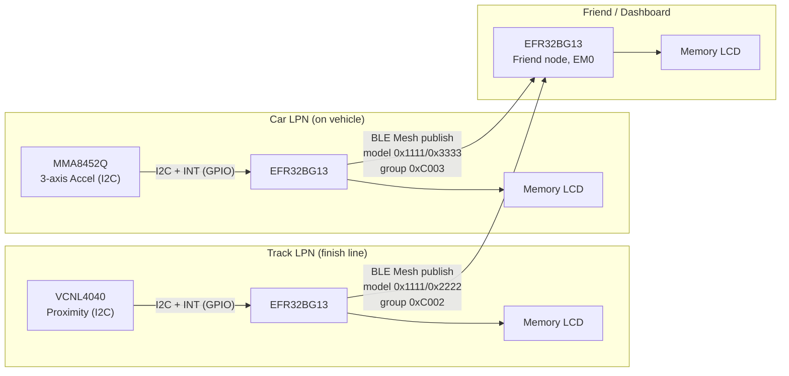

# RC Car Race Tracking & Diagnostic System

**A 3-node Bluetooth Mesh IoT system for automated RC car lap timing and vehicle health monitoring, built on Silicon Labs EFR32BG13 (Blue Gecko) MCUs.**

> ECEN 5823 – IoT Embedded Firmware, University of Colorado Boulder (Spring 2026)
> Authors: Atharv More, Shruti Kalyankar

---

## Overview

RC racing usually relies on manual stopwatches or expensive camera setups, and drivers have no visibility into what happens to the car during a race. This project replaces that with a small, wireless, low-power mesh network:

- A **Track node** sits at the finish line, detects the car passing, and measures lap time and lap count.
- A **Car node** rides on the vehicle, reads acceleration (G-forces), and publishes health data and crash alerts.
- A **Dashboard node** collects everything from both nodes and shows it live on an LCD.

No wired infrastructure is needed. The two sensor nodes are Low Power Nodes (LPNs) that sleep between events, and the Dashboard acts as their Friend node.

---

## System Architecture



| Node | Role | Sensor | Publishes | Energy target |
|---|---|---|---|---|
| **Track LPN** | Low Power Node, publisher | VCNL4040 proximity sensor | Lap count and lap time | Sleep between car detections |
| **Car LPN** | Low Power Node, publisher | MMA8452Q 3-axis accelerometer | Acceleration (X/Y/Z) and crash flag | Sleep between periodic reads |
| **Dashboard** | Friend node, subscriber | none | nothing (receives only) | EM0 (always on to serve the Friend queues) |

---

## Hardware

| Component | Part | Interface | Used for |
|---|---|---|---|
| MCU / radio | Silicon Labs EFR32BG13 (BRD4104A Thunderboard/Wireless STK) | n/a | BLE Mesh stack on all 3 nodes |
| Proximity sensor | Vishay VCNL4040 | I2C (addr `0x60`) + INT pin | Detect the car passing the finish line |
| Accelerometer | NXP MMA8452Q | I2C (addr `0x1D`) + INT pin | G-force monitoring and transient (shock) detection |
| Display | Sharp Memory LCD LS013B7DH03 | SPI | Local status on every node |

---

## Firmware Design

The firmware is written in C on the Silicon Labs Gecko SDK 4.3.2, built with Simplicity Studio 5.

**Layers (bottom to top):**

1. **Drivers:** I2C (`i2c.c`), GPIO (`gpio.c`), LETIMER-based timestamps (`timers.c`), sensor drivers (`VCNL4040.c`, `MMA8452.c`).
2. **Interrupts and scheduler:** ISRs in `irq.c` set event flags in `scheduler.c` inside critical sections. The main loop consumes one event at a time, so ISRs stay short.
3. **Mesh layer:** `BLE_mesh.c` handles node init, self-provisioning, friendship events, and vendor model publish/receive.
4. **Application:** `app.c` reads sensors, packs payloads, and publishes (LPNs) or parses and displays (Dashboard).

**Lap timing flow (Track LPN):**
`car passes → VCNL4040 proximity threshold → GPIO interrupt → ISR sets event → timestamp from LETIMER → lap delta calculated → publish over mesh → Dashboard updates LCD`

**Car health flow (Car LPN):**
`periodic LETIMER tick or accelerometer interrupt → read X/Y/Z → pack payload → publish over mesh → Dashboard shows G-force or IMPACT warning`

---

## Bluetooth Mesh Design

This project uses **vendor models** (not GATT services) and **self-provisioning** (`PROV_LOCALLY`).

### Models and addresses

| Node | Vendor ID | Model ID | Publish group | Subscribe group |
|---|---|---|---|---|
| Track LPN | `0x1111` | `0x2222` | `0xC002` | none |
| Car LPN | `0x1111` | `0x3333` | `0xC003` | none |
| Dashboard (Track model) | `0x1111` | `0x2222` | none | `0xC002` |
| Dashboard (Car model) | `0x1111` | `0x3333` | none | `0xC003` |

The Dashboard registers two vendor models in its Device Composition Data (DCD), one per LPN, and dispatches incoming messages by `model_id`.

### Opcodes and payloads

| Opcode | Name | Sender | Payload |
|---|---|---|---|
| `0x05` | `lap_data_update` | Track LPN | 8 bytes: lap count (`uint32_t`) + lap time in ms (`uint32_t`), little-endian |
| `0x06` | `car_health_status` | Car LPN | 7 bytes: X, Y, Z (`int16_t` each, big-endian) + crash flag (`uint8_t`) |
| `0x07` | `crash_alert` | Car LPN | Same 7-byte layout, sent immediately on impact |

### Data types and update rates

| Measurement | Type | Update rate |
|---|---|---|
| Lap time | `uint32_t` (ms) | On car detection |
| Lap count | `uint32_t` | On car detection |
| Acceleration X/Y/Z | `int16_t` (raw 12-bit counts) | 1 Hz periodic |
| Crash flag | `uint8_t` | On interrupt |

### Provisioning and security

Each node provisions itself on first boot. The unicast address is derived from the two least-significant bytes of the Bluetooth device address, so addresses are unique without an external provisioner. The node then adds the app key, binds it to its model, sets the publish address, and adds subscriptions. On later boots it detects that NVM is already configured and skips setup.

> **Note:** The network/app keys are hardcoded and shared across nodes so the mesh works without a phone provisioner. This is fine for a classroom demo and **must not** be used in a real product.

---

## Low-Power Design

- **LPN friendship:** Track and Car nodes are Low Power Nodes. The Friend node queues messages for them while they sleep.
- **Interrupt-driven sensing:** The proximity and accelerometer threshold interrupts wake the MCU, so there is no polling loop.
- **Event-driven main loop:** The MCU goes back to sleep immediately after each event is handled.
- **Energy modes:** The LPNs are configured for deep sleep between events, with the mesh stack keeping the low-frequency oscillator running for the radio (effectively EM2 while friendship is active). The Friend node stays in EM0 by design.

---

## Results and Known Limitations

**Working**
- 3-node mesh with friendship established between both LPNs and the Friend
- Track LPN proximity detection, lap timing, and lap count published to the Dashboard
- Car LPN periodic accelerometer publishing
- Separate vendor models and group addresses per LPN, with the Dashboard receiving from both
- LCD status on all three nodes
- Hardware-interrupt-driven sensing on the Track node

**Not completed / limitations**
- **Crash detection is simulated in software.** The MMA8452Q stopped responding late in development, so the demo triggers the crash event in firmware. The driver and transient-interrupt configuration are in the repo.
- **Car LPN energy:** The accelerometer was not entering its low-power state between reads, so the Car node's baseline current was higher than targeted.
- **Temperature monitoring (SI7021)** from the original proposal was not integrated.
- **Stretch goals not implemented:** PRS hardware capture of the LETIMER counter, and a high-rate "crash mode".
- I2C runs in blocking mode. Moving to interrupt-driven transfers (holding EM1 only during a transfer) is the next energy optimization.

---

## Design Changes From the Original Proposal

| Planned | Final | Reason |
|---|---|---|
| VCNL4010 | VCNL4040 | Hardware availability, no architecture change |
| MPU6050 | MMA8452Q | Hardware availability, same transient-interrupt capability |
| Assignment 4 base code | Assignment 10 base code | Mesh integration was far easier on the provided BT Mesh example |
| One shared vendor model | One model per LPN | Cleaner separation of Track and Car data |

---

## Repository Structure

```
.
├── ecen5823-courseproject-LPN-track/       # Track LPN firmware (VCNL4040, lap timing)
├── ecen5823-courseproject-LPN-car/         # Car LPN firmware (MMA8452Q, telemetry)
└── ecen5823-courseproject-Friend-dashboard/ # Friend / Dashboard firmware (LCD, receive)
```

Key files in each project:

| File | Purpose |
|---|---|
| `app.c` | Application logic and main loop actions |
| `src/BLE_mesh.c` | Mesh init, provisioning, friendship, publish/receive |
| `src/my_model_def.h` | Vendor model IDs, opcodes, payload lengths |
| `src/scheduler.c` | Event flags set by ISRs, consumed by the main loop |
| `src/irq.c` | LETIMER, I2C, and GPIO interrupt handlers |
| `src/i2c.c` | I2C driver |
| `src/VCNL4040.c`, `src/MMA8452.c` | Sensor drivers |
| `autogen/sl_btmesh_dcd.c` | Generated Device Composition Data (must match the model IDs in code) |

---

## Build and Run

**Requirements:** Simplicity Studio 5, Gecko SDK 4.3.2, three EFR32BG13 (BRD4104A) boards, VCNL4040 and MMA8452Q breakout boards.

1. Import each project folder into Simplicity Studio.
2. Wire the sensors to the I2C pins (PC10 = SDA, PC11 = SCL) and the INT pin to PA3.
3. Build and flash each node.
4. Open the RTT/VCOM console on each board to watch logs.
5. Power the Dashboard first, then the Track and Car nodes.

**Factory reset a node** (do this after changing any model ID, address, or mesh setting): hold **PB0**, press and release the reset button, then release PB0. Reset all three nodes, Dashboard first.

---

## What I Learned

- The **DCD is the source of truth** for mesh models. A vendor ID/model ID mismatch between the DCD and the code fails silently or with opaque status codes (`0x0502`, `0x0403`).
- **Stale NVM provisioning data** survives re-flashing, so a factory reset is part of every mesh configuration change.
- LPNs cannot be relays, and friendship timing (poll window and receive delay) matters.
- Managing Simplicity Studio component dependencies is a skill of its own, since one component change can regenerate the project and drop others.
- Systematic logging after every mesh API call saves hours of guessing.

---

## Demo

[▶️ Watch the demo video](https://drive.google.com/file/d/1BTXHPVNTgMu1sS7w9M5wGsURJEhHmrUn/view?usp=sharing)_

---

## License

Academic project for ECEN 5823. Silicon Labs example code retains its original Zlib license headers.
